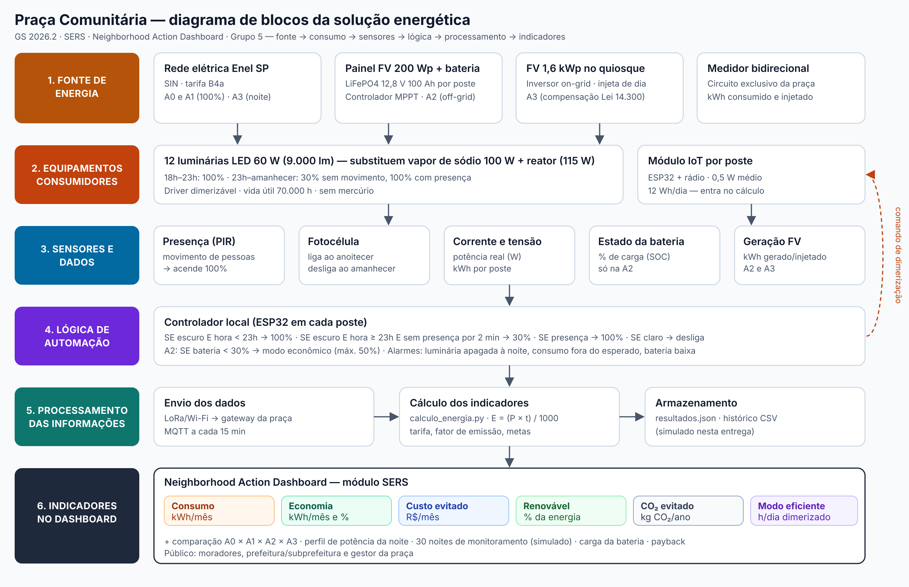
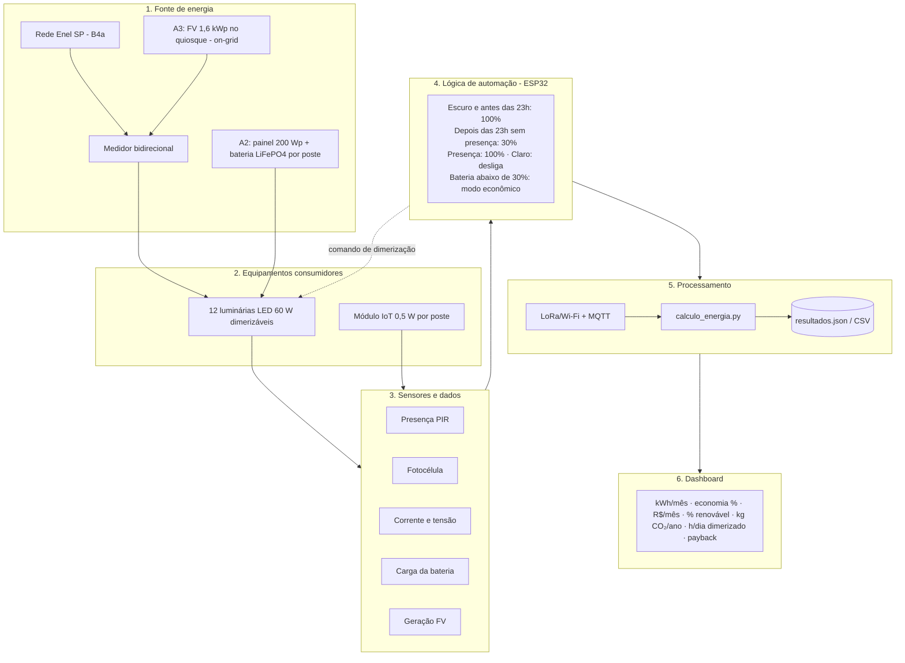

# Praça Comunitária com Iluminação Eficiente e Solar — contribuição de SERS

**Global Solution 2026.2 · Ciência da Computação (1CC) · FIAP**
**Disciplina:** Soluções em Energias Renováveis e Sustentáveis (SERS)
**Desafio integrador:** Neighborhood Action Dashboard — CitizenTech

> Esta pasta (`sers/`) reúne **toda a contribuição de SERS** ao Neighborhood Action Dashboard. Se o repositório for compartilhado com outras disciplinas, a parte de SERS é exclusivamente o que está aqui dentro.

## Integrantes — Grupo 5

| Nome | RM |
|---|---|
| Matheus Roberto | 575653 |
| Gustavo Oliveira Baptista | 575597 |
| Ana Luísa Santos | 574806 |

## Resumo

Uma praça de bairro em São Paulo tem **12 postes com lâmpadas de vapor de sódio de 100 W**, acesas em potência máxima **a noite toda**, mesmo de madrugada, quando quase ninguém passa. Comparamos a situação atual com **três alternativas para a mesma necessidade de iluminação**:

| | Alternativa | Fonte | Consumo da rede | Renovável | Investimento | Payback |
|---|---|---|---|---|---|---|
| A0 | Situação atual (vapor de sódio) | Rede | 491,3 kWh/mês | 0% | — | — |
| A1 | LED 60 W + sensor de presença + dimerização + monitoramento | Rede | 177,6 kWh/mês | 0% | R$ 11.100 | 5,6 anos |
| A2 | A mesma luminária, alimentada por painel + bateria em cada poste | **Solar off-grid** | 0 kWh/mês | 100% | R$ 55.200 | 23,7 anos |
| **A3** | **A1 + 1,6 kWp de painéis no quiosque da praça, ligados à rede** | **Rede + solar on-grid** | 177,6 kWh/mês (compensados) | **99,3%** | **R$ 19.900** | **7,6 anos** |

**Recomendação: A3**, em duas etapas — primeiro a troca por LED com sensores e medição (A1, que já reduz o consumo em 63,9%), depois os painéis no quiosque. A A2 fica indicada apenas para pontos sem acesso à rede ou que precisem continuar acesos durante falta de energia.

Todos os números são **projeções condicionadas às premissas** de [`dados/premissas.json`](dados/premissas.json), não resultados garantidos.

## Estrutura desta pasta

```
sers/
├── README.md                        ← este documento
├── dados/
│   ├── premissas.json               ← todas as premissas, com unidade, tipo e fonte
│   ├── fontes.md                    ← lista de fontes de dados com links
│   └── monitoramento_simulado.csv   ← 30 noites de monitoramento (dados simulados)
├── calculos/
│   ├── calculo_energia.py           ← cálculo completo (Python, sem dependências)
│   ├── memoria_de_calculo.md        ← passo a passo de todas as contas (gerado pelo script)
│   └── resultados.json              ← todos os resultados e indicadores
├── diagrama/
│   ├── diagrama_blocos.svg          ← diagrama conceitual da solução
│   └── diagrama_blocos.png
├── dashboard/
│   ├── index.html                   ← módulo SERS: painel + modo apresentação
│   ├── dados.js                     ← números gerados pelo cálculo (lidos pela página)
│   └── fontes.css                   ← fontes embutidas, para funcionar sem internet
```

---

## 1. Diagnóstico do problema

**Espaço escolhido:** praça comunitária de bairro em São Paulo/SP (caso de referência com cerca de 3.000 m²), com caminhos, área de convivência e uma pequena quadra, iluminada por 12 postes de 5 a 6 m. É um caso hipotético, mas representativo: em 2025 o Inmetro ainda estimava que **59% das luminárias de iluminação pública viária do Brasil usavam lâmpadas de descarga (HID)** e só até 19,6% eram LED.

**Problema energético:**
- Lâmpadas de vapor de sódio de 100 W mais o reator consomem cerca de **115 W por ponto** e ficam em **100% durante as 11 h 52 min da noite**, inclusive de madrugada, quando a praça fica quase vazia. É desperdício de energia e de dinheiro público.
- Luz amarelada com reprodução de cor muito baixa, o que piora a sensação de segurança.
- Trocas frequentes (a cada ~4 anos) e lâmpadas com **mercúrio** (16,3 mg por lâmpada de 100 W), que exigem descarte especial.
- Nenhum dado de funcionamento: uma lâmpada queimada só é descoberta quando alguém reclama.

**Público beneficiado:** moradores do entorno que usam a praça à noite (crianças e jovens na quadra, idosos em caminhada, quem atravessa a praça a caminho do ponto de ônibus), comerciantes vizinhos e a prefeitura/subprefeitura, que paga a conta de energia da iluminação pública.

**Condições de funcionamento:** iluminação do anoitecer ao amanhecer (11 h 52 min por dia, tempo de referência da ANEEL para iluminação pública); uso intenso das 18h às 23h; uso esporádico de madrugada; postes existentes reaproveitados; quiosque/abrigo da praça com cobertura disponível para painéis (premissa da A3).

**Benefícios esperados:** menor consumo e custo de energia, mais luz útil e branca quando há gente (melhor segurança), luz reduzida quando não há ninguém (menos poluição luminosa), detecção automática de falhas, eliminação do mercúrio e participação de energia renovável.

## 2. Análise do consumo energético

Fórmula usada (enunciado): **E = (P × t) / 1000**, com E em kWh, P em W e t em horas.
**Período de referência:** mês de 30 dias e ano de 365 dias, para todas as alternativas. Horizonte de comparação de custos: 10 anos.

### Situação atual (A0)

| Item | Valor |
|---|---|
| Potência por ponto | 100 W (lâmpada) + 15 W (reator) = 115 W |
| Tempo por noite | 11 h 52 min = 11,8667 h |
| E por ponto | (115 × 11,8667) / 1000 = **1,3647 kWh/dia** |
| 12 pontos | 16,38 kWh/dia → **491,3 kWh/mês** → **5.977 kWh/ano** |
| Custo (B4a Enel SP, R$ 0,43416/kWh) | **R$ 213,29/mês** · R$ 2.595/ano |
| Manutenção | R$ 450/ano (troca a cada 4 anos × R$ 150 × 12) |
| Emissões (0,0545 kgCO₂/kWh) | **325,8 kg CO₂/ano** |

### Carga das alternativas (mesma necessidade)

As três alternativas entregam **o mesmo serviço de iluminação** com a mesma luminária e o mesmo perfil de uso, para que a comparação seja justa:

- **Luminária LED de 60 W, 9.000 lm.** Substitui a lâmpada de sódio de 10.600 lm. O LED é direcional e a luminária de sódio perde parte do fluxo no refletor, então a luz útil no chão é equivalente.
- **18h–23h:** 100% (5 h). **23h–amanhecer:** 30% sem movimento; o sensor de presença volta a 100% em ~20% do tempo.
- Fator médio de madrugada = 0,20 × 1 + 0,80 × 0,30 = 0,44
- Horas equivalentes a plena potência = 5 + 6,8667 × 0,44 = 8,0213 h
- E_LED = (60 × 8,0213) / 1000 = **0,4813 kWh/dia**
- Módulo de monitoramento (ESP32 + sensores): (0,5 W × 24 h) / 1000 = **0,0120 kWh/dia** — incluído no cálculo
- **Total: 0,4933 kWh/dia por ponto → 177,6 kWh/mês para os 12 pontos (−63,9%)**

O passo a passo completo, inclusive a análise de sensibilidade com bandeira vermelha, está em [`calculos/memoria_de_calculo.md`](calculos/memoria_de_calculo.md).

## 3. Comparação das alternativas

### 3.1 Números (mesma necessidade, mesmo período)

| Indicador | A0 Atual | A1 LED + sensores | A2 Solar off-grid | **A3 LED + FV on-grid** |
|---|---|---|---|---|
| Energia demandada (kWh/mês) | 491,3 | 177,6 | 177,6 | 177,6 |
| Consumo da rede (kWh/mês) | 491,3 | 177,6 | 0 | 177,6 (compensado pela geração) |
| Geração solar (kWh/ano) | — | — | 2.161 (consumida no poste) | 2.146 (injetada na rede) |
| Economia de energia da rede | — | 63,9% | 100% | 63,9% + compensação |
| Custo de energia (R$/mês) | 213,29 | 77,10 | 0,00 | 14,26 |
| Manutenção (R$/ano) | 450 | 120 | 720 | 270 |
| Participação renovável | 0% | 0% | 100% | 99,3% |
| Emissões evitadas (kg CO₂/ano) | — | 208 | 326 | 325 |
| Investimento inicial | — | R$ 11.100 | R$ 55.200 | R$ 19.900 |
| Economia total (R$/ano) | — | R$ 1.987 | R$ 2.325 | R$ 2.602 |
| Payback simples | — | 5,6 anos | 23,7 anos | 7,6 anos |
| Custo total em 10 anos | R$ 30.451 | R$ 21.680 | R$ 86.400 | R$ 24.335 |

### 3.2 Dimensionamento da alternativa renovável off-grid (A2)

- **Painel:** P = E / (HSP do pior mês × PR) = 0,4933 / (3,8 × 0,75) = **173 Wp → painel de 200 Wp** (folga de 16% em junho)
- **Bateria:** C = E × 2 noites de autonomia / (profundidade de descarga 0,90 × eficiência 0,95) = **1,15 kWh → LiFePO4 12,8 V 100 Ah (1,28 kWh)**, com autonomia real de 2,2 noites e descarga diária de cerca de 41%
- **Controlador MPPT 20 A** com saída dimerizável

**Alerta encontrado na pesquisa:** luminárias solares "tudo em um" vendidas como "150 W" costumam ter painel de **35 W** e bateria de **3,2 V × 39 Ah (~125 Wh)**. Elas não sustentam 60 W reais a noite toda. A potência anunciada não é a potência entregue, por isso dimensionamos a A2 com componentes separados.

### 3.3 Dimensionamento da alternativa renovável on-grid (A3)

- **Geração:** 1,6 kWp × HSP médio 4,9 × PR 0,75 × 365 = **2.146 kWh/ano**, cerca de 99% do consumo anual da iluminação (2.161 kWh)
- A luz funciona à noite e os painéis geram de dia, então a energia é **injetada na rede e compensada** pelo Sistema de Compensação de Energia Elétrica (Lei 14.300/2022). A tarifa homologada da Enel SP já tem linha SCEE para o subgrupo B4a.
- Em 2026, **60% do Fio B não é compensado**. Com a premissa de Fio B = 50% da TUSD, cada kWh compensado vale **R$ 0,356** (contra R$ 0,434 do kWh comprado).

### 3.4 Viabilidade, impactos, benefícios e limitações

| | A1 — LED + sensores (rede) | A2 — Solar off-grid | A3 — LED + solar on-grid |
|---|---|---|---|
| **Viabilidade técnica** | Alta: troca da luminária no poste existente; exige circuito medido para a economia da dimerização aparecer na conta | Média: painel e bateria em cada poste (peso, vento, sombra de árvores, risco de furto) | Alta: cobertura do quiosque com sol livre, inversor e medidor bidirecional; homologação na Enel |
| **Condições necessárias** | Medidor no circuito da praça; luminárias com Inmetro | 200 Wp de sol direto em cada poste; bateria protegida e acessível | Cerca de 8 m² livres e sem sombra no quiosque; adesão ao SCEE |
| **Impacto ambiental** | −64% de energia; fim do mercúrio; menos poluição luminosa de madrugada | Zero energia da rede; 12 baterias de lítio exigem logística reversa ao fim da vida | Energia ~99% renovável em balanço anual; painéis com vida de ~25 anos e reciclagem a planejar |
| **Benefícios** | Melhor retorno financeiro; luz branca; alarme de falha | Funciona durante falta de energia; serve onde não há rede | Quase zero de conta de energia; renovável; mantém a confiabilidade da rede |
| **Limitações** | Continua 100% dependente da rede | Investimento 5× maior que a A1; payback de 23,7 anos, maior que a vida da bateria; reposição das baterias no ano 10 | Apaga durante falta de energia (o inversor desliga por segurança); valor do crédito cai com a Lei 14.300 (75% do Fio B não compensado em 2027 e 90% em 2028) |

**Por que A3:** é a alternativa com fonte renovável que cumpre o objetivo ambiental (99,3% renovável, 325 kg CO₂/ano evitados) com custo total em 10 anos **20% menor que manter a situação atual** e payback de 7,6 anos, bem dentro da vida útil dos painéis. A A1 sozinha tem o melhor retorno financeiro, por isso é a primeira etapa. A A2 não se paga numa praça que já tem rede elétrica, mas é a escolha certa para pontos sem rede ou para manter um caminho iluminado durante apagões.

## 4. Diagrama da solução



Versão em texto (Mermaid, renderizada pelo GitHub):



## 5. Indicadores energéticos e ambientais

Todos saem do mesmo cálculo da seção 2 e aparecem no dashboard:

| Indicador | Unidade | Como é calculado | A3 (recomendada) |
|---|---|---|---|
| Consumo de energia da rede | kWh/mês | Σ (P × t) / 1000 × 30 dias | 177,6 |
| Economia energética | kWh/mês e % | consumo A0 − consumo da alternativa | 313,7 (−63,9%) |
| Redução estimada de custos | R$/mês | (energia + manutenção A0) − (energia + manutenção alternativa) | 213,83 |
| Participação de energia renovável | % | energia solar / energia demandada (balanço anual) | 99,3% |
| Emissões evitadas | kg CO₂/ano | (energia da rede A0 − energia líquida da rede) × 0,0545 | 325 |
| Tempo de funcionamento eficiente | h/dia | horas de madrugada × fração sem presença | 5,5 |
| Retorno do investimento | anos | investimento / economia anual | 7,6 |

## 6. Integração ao Neighborhood Action Dashboard

A página [`dashboard/index.html`](dashboard/index.html) tem duas vistas, todas lendo os mesmos números de `dados.js`:

| Vista | Endereço | Para quê |
|---|---|---|
| Painel | `index.html` ou `#painel` | o módulo de SERS do Neighborhood Action Dashboard |
| Apresentação | `#apresentacao` | a análise em 9 telas 16:9, usada no vídeo |

O painel mostra:
- seletor de alternativa (A1, A2, A3) que atualiza os 7 indicadores;
- de onde vem a energia (rede × solar) em cada cenário;
- custo total em 10 anos (investimento, energia, manutenção);
- potência da praça ao longo de uma noite (efeito da dimerização);
- monitoramento de 30 noites, carga da bateria do poste solar e geração dos painéis do quiosque (**dados simulados**, identificados no próprio painel);
- tabela completa de comparação.

**Como abrir:** abra `dashboard/index.html` no navegador. Funciona offline, sem servidor nem bibliotecas externas (os gráficos são SVG feitos à mão e as fontes estão embutidas).

**Modo apresentação:** botão *Modo apresentação*. Teclas: **→/←** passam as telas, **F** tela cheia, **H** esconde a barra, **1/2/3** escolhem a alternativa na tela do dashboard.

**Como integrar ao dashboard principal:** incorporar a página por `<iframe src="sers/dashboard/index.html">` ou ler os números de `calculos/resultados.json` (mesma estrutura de `window.SERS_DADOS`). Com os sensores instalados, o arquivo `monitoramento_simulado.csv` é substituído pelas medições reais, com as mesmas colunas.

## 7. Como reproduzir os cálculos

```bash
cd sers
python calculos/calculo_energia.py
```

O script lê `dados/premissas.json` e regenera `resultados.json`, `memoria_de_calculo.md`, `monitoramento_simulado.csv` e `dashboard/dados.js`. Para testar outro cenário (outra tarifa, número de postes, HSP etc.), altere a premissa no JSON e rode de novo: painel e apresentação mudam juntos.

## 8. Limitações da proposta

- **Praça de referência hipotética.** Número de postes, horários e presença são estimativas; um levantamento em campo (contagem de postes e de pessoas por hora) refinaria os números.
- **Irradiação solar** (HSP 3,8 em junho e 4,9 na média anual) veio de fontes secundárias que citam o CRESESB/SunData. Antes de implantar, consultar o SunData com as coordenadas exatas da praça e verificar sombras de árvores e prédios.
- **Preços** são de varejo/catálogo e estimativas da equipe, não um orçamento comercial; compras públicas por licitação podem ter valores diferentes.
- **Medição:** iluminação pública sem medidor é faturada por estimativa (potência cadastrada × 11 h 52 min). Sem medidor, a dimerização não reduz a conta. Por isso incluímos o medidor, mas o faturamento por medição precisa ser acertado com a distribuidora.
- **Compensação (A3):** a participação do Fio B na TUSD B4a (50%) é premissa; as regras da Lei 14.300 mudam a cada ano e ainda estão em discussão para 2029 em diante.
- **Payback simples**, sem inflação, juros ou reajuste de tarifa (reajustes aumentariam a vantagem das alternativas).
- **Emissões evitadas são pequenas** porque a matriz elétrica brasileira já é majoritariamente renovável; o resultado muda com o fator de emissão do ano (0,0385 em 2023, 0,0545 em 2024).
- **Monitoramento simulado:** as séries de 30 noites foram geradas com semente fixa para demonstrar o dashboard; não são medições.
- Não foram consideradas a substituição de postes, normas de iluminância (ABNT NBR 5101) por ponto, nem a substituição do inversor da A3 (vida típica de 10 a 15 anos).

## 9. Uso de IA generativa

A equipe usou IA generativa como apoio na pesquisa de fontes, na estruturação dos cálculos e na geração de código. Todos os valores foram conferidos com as fontes da seção 10, e as fórmulas podem ser verificadas na memória de cálculo e no script.

## 10. Referências

Lista completa com o que foi usado de cada fonte: [`dados/fontes.md`](dados/fontes.md).

1. ANEEL — tempo de 11 h 52 min para faturamento de iluminação pública (apresentação na Câmara dos Deputados).
2. Enel SP — Tarifas de energia, REH ANEEL nº 3.596/2026 (vigência a partir de 04/07/2026), subgrupo B4a.
3. O Setor Elétrico — reajuste da Enel SP e bandeira vermelha patamar 1 (R$ 4,463/100 kWh).
4. MCTI — fator médio de emissão do SIN 2023 (0,0385 tCO₂/MWh); Bradesco — Inventário de GEE 2024 (fator do SIN 2024 = 0,0545 tCO₂/MWh).
5. Philips/Signify — ficha MASTER SON-T PIA Plus 100W; LEDVANCE — ficha NAV-T 100 W SUPER 4Y.
6. ORSE — composições 13065 e 13201 (luminárias LED públicas de 60 W).
7. Loja Elétrica e Demape — preços de luminárias públicas LED com Inmetro/Procel.
8. CRESESB — SunData; Energia Solar Explicada e Solar de Casa — HSP de São Paulo.
9. Zilles, R. — IEE/USP, curso IEE0004 (taxa de desempenho de 0,75).
10. Magazine Luiza — preços de baterias LiFePO4 e módulos fotovoltaicos.
11. PowMr e Renogy — preços de controladores MPPT 20 A.
12. SurgePV — custo de sistemas fotovoltaicos em São Paulo.
13. Canal Solar — 60% do Fio B não compensado em 2026 (Lei 14.300/2022, art. 27).
14. O Setor Elétrico — dimerização e telegestão na iluminação pública; ConJur — faturamento por estimativa.
15. Arco Íris LED — especificação de luminária solar "150 W" (painel 35 W, bateria 3,2 V 39 Ah).
16. Inmetro — Análise de Impacto Regulatório de luminárias para iluminação pública viária (2025).
